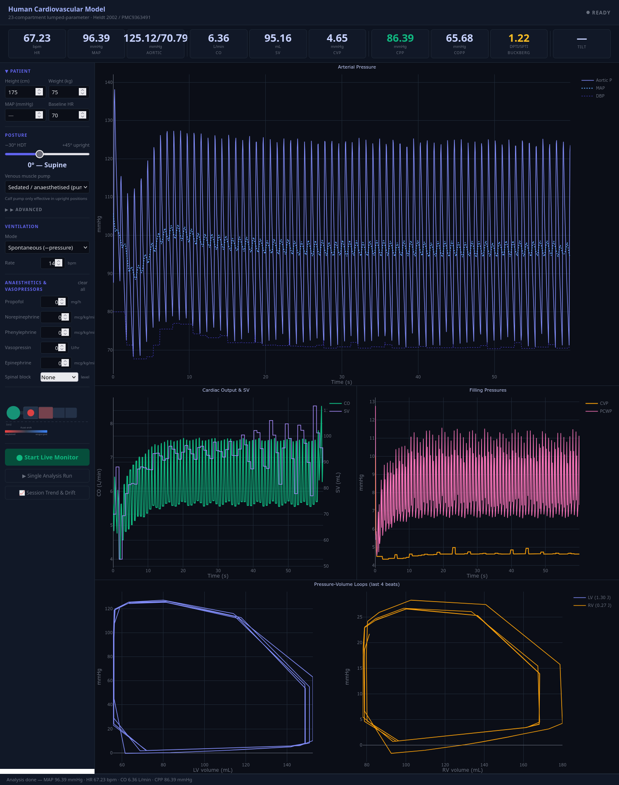
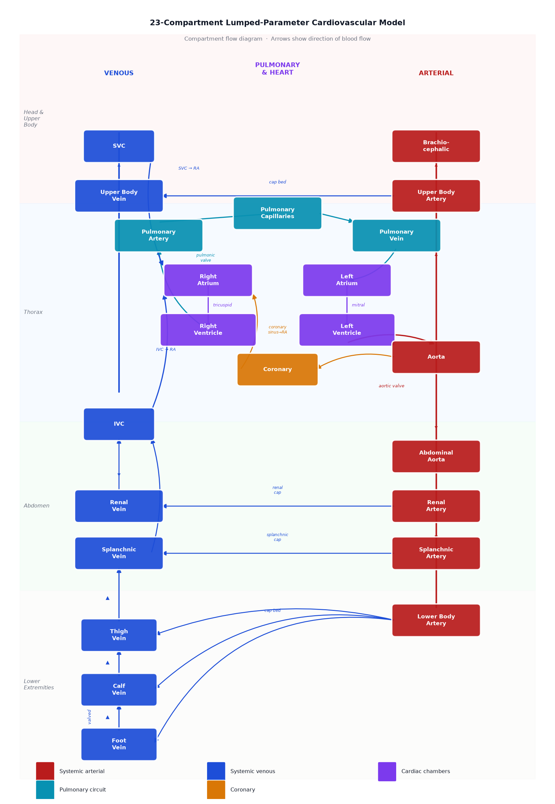

# Cardiovascular System Simulator

> An open-source, lumped-parameter model of human cardiovascular physiology, built for intraoperative and physiological research use.

---

## Overview

The simulator predicts how a patient's circulation responds to posture, vasopressors, fluid, bleeding, ventilation and altered gravity. Inputs scale from the minimal (blood pressure, height, weight, age and sex) to full intracardiac monitoring, so it works with whatever data is available at the bedside.

It is a **work in progress**, and it is built under one rule: **model the physiology as it is measured in people, and never tune a number to make an endpoint come out right.** Every parameter carries a source and an evidence grade. Every validation target is a human measurement matched on site, convention and cohort. A gap that cannot be closed by a structural fix is carried as a strict `xfail` test, so it fails the day it closes and cannot close silently.

One pattern has shaped the project. **Almost every significant error found here was structural, not a calibration problem**, and they shared a signature: *a plausible pressure produced by an implausible volume or flow.* MAP, cardiac output and CVP looked normal through periods when the arteriolar resistance sat on the wrong side of the capillaries, the aortic valve was functionally stenotic, systole lasted a third too short, and the atria could not fill during ejection. None of it was visible in the numbers a clinician watches. So the project measures internal quantities, not only endpoints.

---

## Clinical use cases

| Scenario | What the model predicts |
|---|---|
| **Trendelenburg (head-down tilt)** | CVP and filling, stroke volume and cardiac output, MAP |
| **Reverse Trendelenburg / beach chair** | Venous pooling, orthostatic compensation, cerebral perfusion pressure |
| **Vasopressor titration** | MAP, CO, SVR and heart rate for noradrenaline, phenylephrine, vasopressin, adrenaline |
| **Intraoperative hypotension** | Fluid responsiveness (PPV, passive leg raise), haemodynamic reserve, haemorrhage |
| **Spinal and general anaesthesia** | Sympathetic block, propofol venodilation |
| **Postoperative bed rest** | Cardiovascular adaptation to the supine position |

Microgravity, Mars and Moon gravity are included because weightlessness and bed rest are cardiovascular analogues: both remove orthostatic stress and shift blood centrally. Running the model across the full gravitational range tests the coherence of its hydrostatics.

---

## Quick start

```bash
git clone https://github.com/moelgaardjesper/human-cardiovascular-model.git
cd human-cardiovascular-model
pip install -r requirements.txt

python3 -m api.app          # web interface at http://localhost:5000
pytest                      # fast suite, the regression ratchet (~2 h)
pytest -m slow              # minutes-to-hours dynamics, run on demand
```

---

## Interface



*The analysis view: derived vitals; the aortic pressure waveform with MAP and DBP; cardiac output and stroke volume; filling pressures (CVP and PCWP); left and right ventricular pressure-volume loops with stroke work. The screenshot predates the October 2026 cardiac rebuild, so its numbers are not current. The UI runs fully offline (Plotly is vendored).*

- **Patient panel** — height, weight, age, sex, MAP, HR; optional cardiac output, ABI, CVP, PCWP, PAP.
- **Scenario panel** — tilt (−30° to +45°), vasopressor and dose, spinal block height, ventilation mode, gravity.
- **Output panel** — arterial waveform, cardiac output, CVP, heart rate. A BP-source selector shows central aortic, arterial-line or cuff pressure, so a simulated reading can be compared with the modality actually in use.
- **Live mode** — runs continuously at about real time, with tilt, drugs and ventilation adjustable mid-run.
- **Session trend / drift view** — measured values can be entered as markers on the model's trend. The model runs as a **predictor and is never auto-matched to a measurement**: the gap between the two is the clinical signal (bleeding, sepsis, a drug error), and auto-tracking would erase it.

---

## What the model is

### The circuit

26 compartments: 7 systemic arterial, 11 systemic venous, 4 cardiac chambers, 3 pulmonary and 1 coronary. The lower limb is split into foot, calf and thigh veins, and the inferior vena cava into three segments, so each joins at its own anatomical height. The liver is its own compartment, in series between the portal side (gut and spleen) and the inferior vena cava, with the hepatic artery feeding it directly. Heights come from anatomy (Winter 2009 joint positions, Dempster segment centres; gut and kidney blood at L1) and scale with stature. Gravity acts on every flow path, and with the heart stopped the blood stays still at any tilt. The limb veins follow a nonlinear collapsible-tube law, stiffening where Halliwill 1999 measured it in man.



*The diagram predates the liver split (2026-11-19): the liver, between the portal side and the inferior vena cava, is not yet drawn.*

### The heart

Each chamber is a time-varying elastance. What has been rebuilt against human measurement:

- **Systole is timed as in man.** Ventricular contraction follows the human elastance curve measured by Senzaki 1996, timed in seconds from Weissler's systolic time intervals and the electromechanical delay of Manolas 1975. Ejection time tracks Weissler from 60 to 130 bpm.
- **An aortic characteristic impedance** sits between the valve and the aortic compliance. Central systolic and diastolic pressure are reported at the aortic root, where a catheter reads them.
- **The left ventricle fills along the Klotz 2006 curve**, measured in 80 human hearts, which gives a Starling plateau from structure. **The right ventricle fills along its own measured exponential** (Rommel 2018: multi-beat caval occlusion in human right ventricles, about ten pressure-volume points per subject). The left ventricle's curve failed there, because it left the thin-walled right ventricle slack in early filling. Below rest the measured curve is a little softer than the straight line it replaced (2026-10-31), so CVP now falls slightly less on unloading. It was adopted anyway: the shape is chosen on physiology, not on what it does to one endpoint.
- **The atria fill while the ventricles eject.** The ventricles empty mostly by pulling the valve ring toward the apex, which enlarges the atria (Carlsson 2004, Stephensen 2014). The ring is a piston with two faces of different size. Each atrium gains only the volume its own cross-section sweeps: about 42 % of the left ventricle's swept volume (from Maksuti 2017's measured areas) and 73 % of the right's (Sjöberg 2020). The rest is the small fall in total heart volume, which Carlsson finds at exactly that level.
- **The atria are sized on two independent CMR labs**, appendages included (Maceira 2013 and 2016, Sjöberg 2020). Both atrial reservoirs match both labs (left 23, right 29 mL/m², against 24–25 and 31–32). Until October 2026 the atria were pinned on Järvinen 1994. His absolute volumes read about 1.5× every other source on both sides and were set aside; his emptying ratios agree with the rest and are kept. The left atrial wall is pinned on the reservoir; its waveform then matches direct transseptal pressures in young subjects (Braunwald 1961) without being fitted to them.
- **The ventricles interact through the septum.** The shared wall bows toward whichever ventricle has the lower filling pressure, so loading one relieves the other. One parameter, its stiffness, which no human measurement exists for: it is pinned by the model at the lowest value that reproduces Borlaug 2018's direction, and reported as a prediction. It does not fit both loading and unloading at a single value, which is stated as unexplained.
- **The pericardium is a structure of its own**, holding all four chambers and any effusion, so tamponade emerges. Its capacity is calculated from each patient's own chamber walls at sourced end-diastolic pressures, with the atria at their end-of-contraction volume, because that is where they are at ventricular end-diastole (390 mL in the reference patient; 423 before that was corrected on 2026-11-05). It just meets the heart at end-diastole and is slack through most of a normal beat. **Whether it also carries part of the resting filling pressure in the intact, closed chest is open.** The studies that found no constraint at normal filling (Burger 1995, Mangano) were done with the chest open, and an open catheter in the sac (Sutton 1977) under-reads the contact pressure (Smiseth 1986). They bound the closed-chest constraint from below rather than measuring it. The model can carry a resting share (`pericardial_rest_mmhg`), held at 0 until it is measured. **Around the sac the model now also has a closed-chest constraint** (`chest_p`, below), and the sac's stiffness above its knee, pinned before that layer existed, is due to be re-pinned with it. Its stiffness above the knee was pinned on the ratio of RA to wedge pressure rise on human saline loading (Bhella 2014). That ratio is met only because both rises are about 70 % too large in the model, so the stiffness is a magnitude, not a measurement (grade D).

### The reflexes

- **Arterial baroreflex**, heart-rate arm from Fritsch 1989, plus resistance and venous-tone arms.
- **Cardiopulmonary reflex**, reading the cycle-mean right atrial cavity pressure. It speeds the heart when filling falls, but ignores the first 2.3 mmHg of the fall and then adds 2.5 bpm per mmHg — a **labelled surrogate** (2026-11-21; see the item below). It does not slow it when filling rises, because four labs measured no slowing in healthy volunteers. No Bainbridge acceleration is modelled, because no human magnitude has been read.
- **Limb venous reflex** with the transient time course Samueloff 1966 measured.
- **Reflexes age, and the two arms age differently.** The heart-rate arms follow Gribbin 1971's measured relation, a 5-fold fall from 25 to 68. The vasoconstrictor arm follows Davy 1998, who measured it directly and found it splits in two: nerve traffic per unit stimulus **rises** with age while the vessel's response to that traffic **falls** further, for a net decline about half the heart-rate arm's. They are kept as separate terms because the reflex saturates between them.

### Slower processes and drugs

- **Minutes to hours** (`slow_dynamics.py`, on its own coarse clock): venous stress relaxation, Starling transcapillary filtration and refill, interstitial compliance, RAAS/ADH. The leg veins creep on human values (2026-11-07): under LBNP −70 Lundvall 1993 measured leg pooling complete by ~3.5 min, while the dog time constant kept the model's legs filling for 10 min (+224 mL after 3.5 min). The leg veins now relax with a 70 s time constant and a fraction pinned on Lundvall's 870 mL; the total-to-elastic ratio then lands at 1.50, inside the 1.46–1.83 that Halliwill 1999's step and ramp curves imply. Capillary filtration is shared by tissue mass, legs 0.34 and upper body 0.16 (were 0.20 and 0.30, against Lundvall's 23-24 kg of leg and 10-12 kg of upper body), so plasma loss at 10 min is 373 mL against his 491 ± 29 — a dose-dependent comparison, since the model's suction acts on the legs only while Lundvall's chamber sealed at the iliac crest, and so reported rather than asserted (186 before the change; 408 before the trunk veins' stress relaxation moved from the dog value 0.30 to human bounds (0.15, now 0.11), 2026-11-12, which also brought leg pooling to 931 mL against his ~870; 373 mL and 934 mL after the heart's re-solve, 2026-11-14).
- **Pharmacology:** Hill-equation dose-response for noradrenaline, phenylephrine, vasopressin, adrenaline, propofol and spinal anaesthesia, acting on resistance, venous tone, contractility and heart rate.
- **Ventilation:** spontaneous and mechanical, intrathoracic pressure applied to every thoracic compartment, respiratory sinus arrhythmia, PEEP.

### The patient

Patients scale from the reference by body surface area, sex (Luu 2022, Gao 2022 chamber volumes) and age (arterial stiffening, ventricular volumes, reflex responsiveness). Three input tiers:

| Tier | Inputs | What is estimated |
|---|---|---|
| **1 — Minimal** | MAP, height, weight, age, sex | Everything, by allometric scaling (Mosteller BSA) |
| **2 — Intermediate** | + cardiac output, ABI | Arterial resistance, peripheral disease |
| **3 — Advanced** | + CVP, PCWP, mean PAP | Intracardiac calibration |

---

## How it is validated

- **Every number has a source, and the convention is part of the number.** A pressure constant states its site, whether it is transmural or intraluminal, and its averaging window. Cuff against central pressure, trough against mean CVP, and breath-hold against free-breathing MRI have each caused a false "error" here before they were caught.
- **Evidence grades A–F.** A matched human measurement (A) or independent agreeing sources (B) may be calibration targets. Weaker evidence is used as a labelled best guess. A parameter with no literature value (E) is allowed only if it is pinned from one endpoint and tested on others. A parameter kept against contradicting literature (F) must be named publicly.
- **Pin, don't pick.** When a parameter is set from one human measurement, the measurements it was not set from are the test. Several pins in the cardiac rebuild then matched data they never saw.
- **The suite is a ratchet.** A change that cannot leave it green without weakening a test is a finding to report, not a licence to retune. Known gaps are strict `xfail`s, and each fails the moment it starts passing. **No band has been widened to absorb a model result.** The suite-wide convention is a 1 SD band around the source mean.
- **Guards are sabotage-verified.** A new guard is trusted only after the mechanism it watches has been broken and the guard has fired.
- **Blind validation.** Predictions for unseen studies are committed publicly before the result is known (see [Blind validation](#blind-validation-in-progress)).

### Test suite (measured 2026-11-04)

| tier | command | result |
|---|---|---|
| fast — the ratchet | `pytest` | **156 passed, 37 strict xfails, 0 failed** (11 slow tests deselected. 2026-11-22, later: two tests built on lower-body suction magnitudes retired and their claims moved to real blood loss and tilt — Johnson 2014's MAP test split from its heart-rate half (the MAP half passes; it had been hidden), and a new White 1997 test that the young raise MAP at 60° (a strict xfail: the 60° collapse, central MAP −25 mmHg); a measured CVP of 0 is no longer replaced by 5 in patient calibration. Earlier the same day: the cardiopulmonary heart-rate threshold adopted as a surrogate — the full suite on the identical law (probe) plus every touched test re-run: five strict xfails closed, three opened, two guards split so their LBNP-sized and large-stress halves are strict xfails of their own. 2026-11-21: four literature replays added and run on their own — Giuntini 1966 and Hirakawa 1995 on the pulmonary bed (one passes, one a strict xfail: the two volume methods disagree ~3x and a linear bed cannot hold both), Kostas 2014 at 20° head-up (heart rate and stroke volume, two strict xfails beside Petersen: problem 1), Warren 1992 on calf elevation (the end point passes, the speed is a strict xfail). Run in full the same day after the venous-return test moved onto Maas's TRUE breath-holds and became a strict xfail — see the venous return item below. 2026-11-19: after the head-down column was re-pinned to 0 and seven literature results were added — Petersen 2014 and van Lieshout 2005 as strict xfails (problem 1 had no test), Bivins 1985 as the new pin's guard, Kiszka-Kanowitz and Lautt for the liver, Johnson 2014's MAP and heart rate on real blood loss. Earlier the same day with the liver split: Lie's graded haemorrhage became a strict xfail — the liver moves stroke volume toward man and unmasks the heart-rate arm's over-response, +6 bpm at 300 mL against Johnson's +1 — and the central-hypovolaemia MAP xfail closed by a hair; the venous-return test re-scoped to Maas's own protocol; the arrested-circulation guard now reads the ODE's own pressures and asserts no flow through the stopped heart. 2026-11-17: the full run with leg blood flow on Dinenno 1999, which closed four xfails and tipped two edge-sitters into strict xfails; two thresholds without a source re-expressed on what their sources claim; then the cardiopulmonary reflex's reference CVP re-measured to its fixed point, 5.23 → 6.21, which removed a ~1 mmHg dead band and turned the young-men central-hypovolaemia test into a strict xfail — re-checked on the 24 reflex-sensitive tests) |
| slow — minutes to hours | `pytest -m slow` | **7 passed, 2 strict xfails** (re-run 2026-11-19 with the liver split; 2026-11-14: the body-alone Johnson pin flipped when the RV was re-placed, and its pump harness can no longer reach stage 3 — the frozen ventricles hold the heart's external pressure; a harness rebuild is owed). The trunk veins' stress relaxation now sits on human bounds instead of a dog calibration: fraction 0.11 (was 0.30; 0.15 on 2026-11-12, re-solved on the new heart 2026-11-13), between Echt 1974's floor (at least 6 % of a pressure rise gone in a 10-min pause; the model 6.2 %, and 5.8 % at 0.10) and Gauer 1956's ceiling (at most ~20 % in 30 min; 2 %), and picked by Johnson 2014's bleed with the heart replaced by two pumps, where the body alone fell inside all three bands (on their edges). Both are slow tests, and both fire when broken (0.30 fails Johnson; 0 fails Echt). After the heart's external pressure was re-solved (2026-11-13) 0.15 left the pin just outside (−2.27 / −3.28 against edges −2.34 / −3.34); 0.11 is the lowest value inside Echt's floor that passes it, and it passes the middle stage by 0.002 mmHg — the human floor and the pin now meet, so this value is fragile in both directions. The older relaxation test keeps only a liveness floor (5 %). The xfail is the hormonal reserve after a 1 L bleed, broken by the closed-chest constraint, which leaves a smaller pressure deficit to unmask it ||
| overnight — 24 h refill | `pytest -m overnight` | 1 strict xfail, predicted before it was run |

The model cites **132 distinct sources: 56 asserted by a passing test (5 of them in the slow tier), 37 appearing only in strict xfails (recorded disagreements), and 39 cited in the code as parameter justifications that no test asserts** (counted 2026-11-19 by `tools/source_index.py`, after the literature batch; the 2026-11-03 count was 118 = 69 / 14 / 35, and the tool's categories have since changed, so the two splits are not directly comparable). These are different claims and are counted separately. The list is generated by `tools/source_index.py`, never kept by hand. **The previous count (65 / 9 / 32 of 106) was inflated.** Until 2026-10-24 the tool let a section's citations, and the test file's opening reference list, leak over every later test, so some papers were credited to up to 26 unrelated tests. Sections are now scopes, and reference tags such as "[14] Hamilton" are resolved to the test that cites them.

---

## Validation results

All values re-measured on **2026-10-27**, at the current commit, through the same helpers the tests use. The left-heart rows (PCWP, stroke volume, LA volumes, pulmonary blood volume) were updated on **2026-11-03** by the measured paired effect of removing the pulmonary venoatrial resistance; every other row was re-checked unchanged to its rounding. Scenario rows use the test protocol (a 40 s run, averaging its second half), so a few posture responses read slightly larger than in a fully settled run.

### The resting operating point — reference patient (male, 55 y, 175 cm / 70 kg)

| Quantity | Model | Human reference |
|---|---|---|
| MAP (central, integrated) | 94.9 mmHg | 95 ± 7 (McEniery 2005, males 50–59) |
| Central systolic / diastolic | 134 / 80 mmHg (pulse pressure 55) | invasive-equivalent ~123 / 72, PP ~50 ± 7 (McEniery corrected for cuff calibration, Cheng 2013) |
| Heart rate, stroke volume, CO | 68 bpm, 89 mL (48 mL/m²), 5.9 L/min | HR 65 ± 11 (McEniery); SV index 46 ± 8 mL/m² (Luu 2022) |
| CVP (catheter mean) / PCWP | 5.3 / 10.7 mmHg | RA 3 [2–6] (Richter 2021); PCWP 8 ± 2 (Condos 1987) |
| LV end-diastolic volume, EF | 76 mL/m², 63 % | 74 ± 13 mL/m², 62 ± 6 % (Luu 2022) |
| RV end-diastolic volume | 93 mL/m² | 86 ± 16 (Luu 2022) |
| RA maximum volume | 55 mL/m² | 54 ± 10 (Maceira 2013, n = 120); 66 ± 11 (Sjöberg 2020) — appendage included |
| LA maximum / minimum volume | 44 / 21 mL/m² | 44 ± 6 / 18 ± 4 (Sjöberg 2020); ~41 / ~17 (Maceira 2016, derived) |
| Atrial reservoir, left / right | 23 / 29 mL/m² | 24 ± 4.4 / 31 ± 6 (Maceira 2016); 25 ± 4 / 32 ± 5 (Sjöberg 2020) |
| Atrial filling during ejection | 49 % of ejected volume; right atrium 55 % of its inflow | 64 % (Carlsson 2004); right atrium 63 ± 9 % (Sjöberg 2020) — the two disagree, see limitations |
| RA waveform (a wave above mean; x descent below) | +1.1 / −2.1 mmHg | ~+2 (Condos 1987); ~−3 (Ferguson 1989) |
| Pulmonary blood volume | 522 mL | 526 ± 87 (Ugander) |
| Total blood volume | 5.13 L | |

### Scenarios

| # | Scenario | Reference | Literature | Model (2026-11-19, `tools/validation_table.py`; rows 2, 4, 8–10, 16–19 not re-measured — their values date from 2026-10-27 or earlier) | |
|---|---|---|---|---|---|
| 1 | 20° head-down, normovolaemic | [Sejersen 2022](https://doi.org/10.14814/phy2.15216), 10 healthy men | ΔSV ≈ 0, ΔCO ≈ 0, ΔMAP +2 (n.s.) | ΔSV +6.4 mL, ΔCO +0.30, ΔMAP +3.1 | magnitude a known gap |
| 2 | −15° Trendelenburg | [Likhvantsev 2025](https://doi.org/10.1053/j.jvca.2024.10.001), meta-analysis n=333 | ΔCVP +4.13 (CI 2.42–5.84), ΔCO +0.33, ΔSV +8.27, ΔHR −1.65 | ΔCVP **+2.02**, ΔCO +0.77, ΔSV +13.3, ΔHR −1.6 | CVP inside the test band (1.5–7.0) but below the CI; flow ✓ |
| 3 | −30° Trendelenburg | Likhvantsev 2025; [Sibbald 1979](https://pubmed.ncbi.nlm.nih.gov/467083/) | as above; MAP maintained | ΔCVP +6.8, ΔCO +0.37, ΔSV +7.4, ΔHR −1.3 | flow ✓; **CVP above the CI** (+10.0 before the head-down column was re-pinned to 0 on 2026-11-19; the head-down CVP excess is problem 1, see Posture) |
| 4 | 6° head-down vs 20° upright | [Verdini 2019](https://doi.org/10.1038/s41598-019-39360-6), 17 men | HR lower head-down; MAP lower head-down | HR 67.8 vs 72.9 ✓; MAP 100.3 vs 86.6 (order opposite) | ✓ on HR |
| 5 | 30° head-up | [Wieling 1998](https://doi.org/10.1042/cs0940347) | SV and CO fall, MAP defended (at 90°: MAP +1 ± 7) | ΔSV −20 %, ΔCO −14 %, ΔMAP −6.6 | direction ✓; MAP still falls where Wieling's subjects held it |
| 6 | Graded head-up 0 → 20 → 30° | [Sarafian 2017](https://doi.org/10.3389/fphys.2016.00656) | HR up, CO down, monotonic | HR 69 → 73 → 75, CO 6.38 → 6.04 → 5.50 | ✓ |
| 7 | Cerebral perfusion at 45° upright | [Pohl & Cullen 2005](https://pubmed.ncbi.nlm.nih.gov/15983529/) | falls; risk below 50 | 88 → 65 mmHg | ✓ above the 50 risk line |
| 8 | Passive leg raise | [Monnet 2016](https://doi.org/10.1007/s00134-015-4134-1), 21 studies | responder ≥ +10 % CO; specificity 0.91 | normovolaemic +8.2 % ✓ (2026-11-09); after 1200 mL +59 % ✓ | both ✓; the non-responder passes by a small margin |
| 9 | Pulse pressure variation, ventilated | [Michard & Teboul 2000](https://doi.org/10.1164/ajrccm.162.1.9905119) | > 13 % predicts fluid response | normovolaemic 8.3 % ✓; 1000 mL bleed 24.4 % ✓; after fluid CO +84 %, PPV 22.3 % | ✓ (the fall in PPV with fluid is small) |
| 10 | Saline loading, external share | [Bhella 2014](https://pubmed.ncbi.nlm.nih.gov/25236519/), healthy seniors | ΔRAP / ΔPCWP 0.59–0.64; ΔPCWP +4.4–5.5, ΔRAP +2.6–3.5 | ratio 0.82; ΔPCWP +6.2 (was +8.9), ΔRAP +5.1 | wedge closer with the septum; the ratio left its band when one of two cancelling errors was fixed |
| 11 | Microgravity CVP | [Buckey 1996](https://pubmed.ncbi.nlm.nih.gov/8853498/) | orbit ~2.5, above upright Earth | 6.09 vs 2.23 at 45° upright | ✓ order |
| 12 | Phenylephrine, young men | [Schäfers 1999](https://pubmed.ncbi.nlm.nih.gov/10073742/) | ΔMAP +28 (21.3–34.7), ΔHR −16, ΔCO −1.15, ΔSV +9 | 4 µg/kg/min: ΔHR −13.7, ΔCO −1.77, ΔSV −8.8 (2026-11-19; ΔMAP not reported by the tool. On 2026-11-12: ΔMAP +18.1, ΔHR −14.0, ΔCO −1.09, ΔSV +1.5) | **CO now outside Schäfers' band** (−1.30 to −0.04; base −1.76, so not the liver — moved between 11-12 and 11-17, not yet traced); pressor a strict xfail again since 2026-11-07 (plateau +20.2 against 21.3), when the chambers took the raw age ratios and the young heart's under-filling showed; the heart-rate response in tilt (Højlund) and phenylephrine's abolition of preload dependency are now strict xfails |
| 13 | Noradrenaline vs phenylephrine, spinal | [Ngan Kee 2015](https://doi.org/10.1097/ALN.0000000000000601), n=104 | NE preserves CO better; NE HR higher | CO 5.99 vs 5.36; HR 66 vs 62 | ✓ |
| 14 | Vasopressin dose-response | [Patel 2002](https://doi.org/10.1097/00000542-200203000-00011) | MAP rises with dose; CO maintained | MAP 98 → 116 → 122; CO 6.38 → 5.53 | ✓ |
| 15 | Adrenaline dose-response | [Freyschuss 1986](https://doi.org/10.1042/cs0700199) | CO rises with dose; MAP higher at high dose | asserted pattern passes in the suite | ✓ |
| 16 | Spinal anaesthesia ~T4 | [Malmqvist 1987](https://doi.org/10.1111/j.1399-6576.1987.tb02605.x) | MAP falls; CO maintained | asserted pattern passes | ✓ |
| 17 | Buckberg index with heart rate | [Buckberg 1972](https://pubmed.ncbi.nlm.nih.gov/4667030/) | falls with tachycardia | 1.21 at 70 bpm → 0.45 at 160 bpm | direction only (see limitations) |
| 18 | Noradrenaline postcapillary constriction | Abboud & Eckstein 1968 | venous/arterial slope ratio 1.80 | 1.84 | ✓ |
| 19 | Transcapillary refill, 2 h | Lister 1963 | incomplete at 2 h | passes (slow tier) | ✓ |

### Recently closed, by structure rather than calibration

- **Head-down and leg-raise over-filling.** With the pericardium's knee at the resting heart, a full heart stops filling while a bled heart still responds. The Monnet non-responder and the Likhvantsev CVP rise at −15° closed together.
- **Systolic timing.** Ejection lasted 193 ms at rest (man ~294) and shrank with the beat. With measured timing and an aortic impedance, peak aortic flow per stroke volume then matched MRI without being used.
- **The atria (October 2026, twice).** First their old sizes came from an atrial body without the appendage, and their contraction double-counted the emptying the valve ring does. Then the valve ring's swept volume was found to enter each atrium one-for-one, against the geometry: both atria were about 1.5× too large and over-filled every beat. Splitting the sweep by measured areas and re-sizing on two independent labs closed the left reservoir (+2.6 SD → on target), the right (+1 SD → on target) and both emptying gaps.
- **Phenylephrine's pressor response** is a calibration on Schäfers. Its ceiling was re-set 2.10 → 2.15, the top of its documented window, when the atria were re-sized. Stroke volume rises at every dose.

---

## Limitations

The frozen list is in [`FREEZE.md`](FREEZE.md); if the two disagree, `FREEZE.md` wins for the v1.0.0 artefact. Each item below is carried as a strict `xfail` unless stated.

**The heart**
- **The left-heart walls are too stiff on loading.** *Partly resolved 2026-10-30:* with ventricular interaction through the septum, opening the pericardium now *lowers* the wedge rise (+6.2 → +6.1), the direction Borlaug 2018 measured, for the first time in this model. The magnitude is far short of her −67 %, and the wedge rise itself (+6.2) still exceeds the measured 4.4–5.5. Older women start too high on their filling curve (resting wedge 14.5 mmHg in Bhella's cohort, men 11.2, against 10.9 ± 2.0). Two tweaks were tested on 2026-10-17 and neither was adopted. Re-placing the LV filling curve on the wall's share of wedge pressure changed nothing. A stiffer right-ventricular filling law halved the over-filling and improved posture, but broke the saline ratio.
- **The heart turns volume into the wrong pressure, in both directions (October 2026).** Replaying Bhella 2014 stage by stage, from −30 mmHg suction to saline, the left ventricle receives the measured volume at every stage, so the body delivers correctly. But right atrial pressure falls about 0.4 of the measured amount and rises 1.6× it. Since the septum (October 2026) the wedge shows the same shape: it falls about 0.7× the measured amount on unloading and rises 1.3× it on loading. Before the septum it fell 1.5× too much. On controlled blood loss in awake men (Johnson 2014, three 333 mL withdrawals), CVP fell about 3× too little (−1.4 against −4.7 mmHg at 1 L) while stroke volume fell about 1.7× too much; with the closed-chest constraint below (2026-11-06) the pair is −2.2 mmHg and −26 mL against −4.7 and −18. Re-sizing the atria (October 2026) moved these little: the atria are not the cause. Reflexes and transcapillary shifts were excluded by switching them off. A joint search of 512 combinations of 11 heart and body parameters found none with a normal resting state that also loads like Bhella's subjects. Two candidate fixes failed pre-registered tests: a pericardium engaged at rest (30 configurations), and a curved right-ventricular filling law across its measured range. The second exposed the shape of the problem. With chambers coupled only in series, the right heart can either pass volume on (and RA pressure does not move) or hold pressure (and the left ventricle is starved of volume). People do both. Two later tests, run on the corrected atria (October 2026), narrowed it further. A minimal passive septum fixes much of the wedge error and reverses Borlaug's direction (opening the sac now lowers the wedge rise, as in her patients), but no single septal stiffness fits both loading directions, and it leaves the right atrium untouched. Combining it with a stiffer right ventricle improves the bleed (CVP −2.5 at 1 L) and worsens saline loading (RAP +6.0), so the right atrial error is one-sided in opposite directions: it falls too little on unloading and rises too much on loading. No ventricular stiffness can fix both. A third test (October 2026) moved the pericardium's resting position across its plausible range: bleeding never reaches the sac, and saline over-shoots even with the softest one. **The October conclusion that the error lies in the right atrium's wall or the veins is withdrawn (2026-11-06).** Making the splanchnic veins stiffer sends more of a volume change into the chest, but the heart then loses more volume and output while CVP barely moves, so the veins are not the lever. In healthy, closed-chest man a volume change shows up as a change in filling pressure with ventricular volume largely preserved (Oren 1993, Cléroux 1989, Echt 1974, Johnson 2014); in the model it showed up as lost volume and output. The defect is in the central pressure–volume relation of the heart and its surroundings. **Since 2026-11-12 the suction stages are tested as an ordering, not as sizes**: the model's suction acts on the legs only, while the human chambers seal at the iliac crest with the pelvis inside, so the blood moved per mmHg differs. What does not depend on that dose is tested instead, as two relations between quantities measured at the same moment. Both fail, and both are the heart: wedge pressure per 10 % of LV volume is 6.0 mmHg at −15 against 2.4–4.8, and 16.5 on saline against 4.3–9.2 (right only at −30); and at −30 the right atrium falls 0.56 of the wedge fall against 0.62–0.83.
- **The pressure around the heart, re-solved (2026-11-13).** The external pressure on the four chambers is now read as the sum of chest wall, mediastinum and lungs, and pericardium at normal volumes (pleural pressure is separate). Belenkie 2002 measured the chest-closure part (about 1.5–2 mmHg, pericardium open) and Tyberg's and Hamilton's balloon studies the pericardial part, so the resting value is 3.0 mmHg (grade C/D, two partial sources added; conflict H). Its slope is now different on each side of the resting heart volume: 0.08 mmHg/mL below it, 0.05 above it (both grade D). The reason is a cap the probes exposed: an external pressure can lower CVP by at most what it carries at rest. At 1.75 mmHg and the old slope it was used up by the first 333 mL of Johnson's bleed, so the rest of the fall had to come out of the heart's volume, which is the fingerprint this project has chased since October. With the new values Johnson's CVP falls −1.32 / −2.50 / −3.37 mmHg at 333 / 666 / 999 mL, inside all three bands for the first time, and stroke volume −22 mL at 1 L against −18 (was −29). The right atrium now falls with the wedge at −30 mmHg suction, and Bhella's saline LV volume is inside its band. It costs seven sourced tests, each now a strict xfail with its suspected cause: the atrial reservoir and emptying fraction, the LV's ordering with age, a normovolaemic leg raise, a 30° tilt floor, phenylephrine's bradycardia in tilt, and the body-alone Johnson pin. The atria are re-placed for the whole 3 mmHg although the pericardial part acts mainly at ventricular end-diastole, and that is the leading suspect for the atrial pair. The LV's wedge per volume at −30 mmHg is still too steep (3.7 against at most 3.2), and saline still raises the wedge too much (+7.5 against 4.1–5.75).
- **The heart's surroundings use an anatomical reference, and blood volume falls with age (2026-11-15).** The external pressure on the heart now compares the heart's end-diastolic volume with its calculated anatomical size from the first beat; until then its reference was measured from each run at 60 s, so it never responded in shorter runs (the 30 s leg raise, the 40 s tilt) and treated a patient who starts tilted as being at rest. Blood volume now follows age (Davy & Seals 1994: 3160 against 2438 mL/m² at 25 and 66 years in men matched for size and activity; the ratio only, grade C, the vessels only, unchanged at the reference age of 55). Without it a 32-year-old had the 55-year-old's blood volume and his heart sat 52 mL below its anatomy. Together they put every dose-free heart relation of this week inside its band, keep Johnson's CVP inside all three bands (−1.34 / −2.76 / −3.65), bring Johnson's stroke volume to −5.7 / −12.2 / −21.5 mL against −5 / −11 / −18, and close seven xfails (the leg raise, the 30° tilt, PPV, cerebral perfusion at 45°, phenylephrine's bradycardia in tilt, the LV's ordering with age, the LV's filling pressure per volume). The cost is in young absolute values (resting stroke volume at 22 years 89.7 against at most 86.3; phenylephrine's output fall at 27; the wedge–LVEDP gap at 29) and in pulse pressure, which no longer widens with age because older patients now carry less blood; each is a strict xfail. Davy's ratio comes from an Evans-blue cohort of 7 + 7 men in which fitness also differed. **Its shape since 2026-11-16**: Davy measured two ages, and the straight line between them was the model's choice. Wennesland 1959 (201 men, chromium-labelled red cells, a different lab and method) found blood volume for size unchanged from 19 to 44 years, so it now stays at the young level to 45 and falls to Davy's older level at 66 (two routes, grade C). On Davy's own scale the reference patient's blood volume then sits at 56 years, consistent with its reference age of 55 (47 years under the straight line). Johnson's CVP stays inside all three bands (−1.44 / −2.85 / −3.44) and his stroke volume falls −5.4 / −11.4 / −17.8 mL against −5 / −11 / −18 since the leg-flow correction below (−6.2 / −12.6 / −24.2 before it; −5.7 / −12.2 / −21.5 under the straight line); resting stroke volume at 22 years is 87.7 (still above 86.3), and the other young values and pulse pressure are unchanged in kind. It cost three of Bhella's dose-free relations in 69-year-olds, which now carry 6.5 % less blood: wedge per 10 % LV volume at −30 mmHg suction 2.12 against at least 2.13, the right atrium's fall per wedge fall 0.57 against at least 0.62, and saline's LV volume rise +10.7 % against at most +10.5 %. The last two sat near their band edges under the straight line too (0.64, +9.3 %); all three are now strict xfails, so not every dose-free heart relation is inside any more.
- **A closed-chest constraint on the heart (adopted 2026-11-06; re-solved 2026-11-13, above).** Closing the sternum with the pericardium left open shrinks the left ventricle at unchanged wedge pressure in patients (Belenkie 2002), so the lungs and mediastinum press on the heart beyond what the sac does. The model now carries that as an external pressure on all four chambers that follows the heart's volume averaged over several beats, because lungs and mediastinum do not follow each beat. Its resting value (1.75 mmHg) is from Belenkie (grade C, ventilated surgical patients); its slope is pinned on one study (Oren 1993, grade D), and is provisional since 2026-11-12, because Oren's pressure change at −10 mmHg suction depends on a dose the model's suction does not reproduce. Against data it was not fitted to, it moves the model toward man: LV volume change per mmHg of CVP on mild suction 2.0 % against Cléroux's 2.4 % (was 8.2), the bleed side of Echt's volume test, Johnson's stroke volume, and cardiac output at −40 mmHg suction. It closed three old gaps and opened seven, mainly in young subjects at mild unloading, where it holds stroke volume too well. It was adopted although it missed one pre-registered criterion (Johnson's CVP moved a quarter of the gap, not the required third).
- **Chamber walls follow the raw sex and age ratios (2026-11-07).** Luu's and Gao's female/male and age ratios used to be divided by a "transmission" measured on the model, so that an assigned wall would land the chamber on the target volume. On the rebuilt heart a bigger wall barely changes the chamber's volume and mostly lowers its filling pressure: the circulation decides the volume, the wall the pressure at that volume. The walls now follow anatomy, and the volumes are tested as outcomes. Three strict xfails closed (female RA volume, the age shape of pulse pressure, phenylephrine bradycardia in tilt); Schäfers' pressor response in young men fell 1.1 mmHg below its band. 
- **The atria are re-placed for the closed-chest constraint (2026-11-08).** The constraint is averaged over about 2 s, so it acts through the whole beat, atrial filling included, but only the ventricles' walls had been re-placed for it. The atria's passive stiffness is now scaled the same way as the RV's, with their resting pressures taken from the sourced ventricular filling pressures. Resting CVP moves only −0.07 mmHg, but two strict xfails closed: Monnet's normovolaemic leg raise (+8.2 %) and Järvinen's left-atrial ejection fraction (22.6 %, against 28 ± 7, inside one SD but near its lower edge).
- **Body size now scales every extensive quantity (2026-11-07).** Patients were scaled from the reference by body surface area on volumes and compliances only; no resistance and no cardiac elastance scaled. A large patient therefore had a big heart driven by a small body's resistances and sat low on its own curve: at 185 cm / 91 kg, wedge 6.9 against the reference patient's 9.6, LVEDV 68 against 75 mL/m². Resistances (including the venous junctions) and elastances now fall as 1/size and compliance-like cardiac quantities rise with it, as clinical indexing (cardiac index, SVR index) assumes; the reference patient is unchanged, and the fully scaled large patient reproduces its operating point (wedge 9.7, LVEDV 75 mL/m², CI 3.22). Height and age contributed little. Johnson's 32-year-old (BSA 2.17) now sits at LVEDV 74 mL/m² and wedge 8.3, up from 67 and 6.1; Luu's young ventricle is 77 mL/m². Schäfers' pressor response runs on the reference body age-matched to 27, so size scaling cannot reach it; it stays a strict xfail.
- **Head-down filling is still too large** at 20° (Sejersen) on the test protocol.
- **Atrial filling during ejection reads 48 % against Carlsson's 64 %**, and the net fall in heart volume 0.52 of the ejected volume against 0.26–0.37. The newer data from the same lab (Sjöberg 2020) put the right atrium's systolic inflow at 63 ± 9 % (model 56) and cap the two atria together near 55 %, so the two papers disagree. The heart-volume fall is not a matched comparison: their heart volume includes the great-vessel roots inside the pericardium, which fill during ejection, and the model has no such compartment.
- **The right-atrial waveform is flatter** since the atria were re-sized: a wave +1.1 above the mean (Condos ~+2), x descent −2.1 (Ferguson ~−3).
- **A normovolaemic leg raise raises CO 8.2 %**, under Monnet's 10 % non-responder cut-off (2026-11-09). It was 9.7 % on 2026-11-03, 10.7 % once the closed-chest constraint arrived, and came back under when the atria were re-placed for that constraint (below).
- **The LVEDP–wedge gap in healthy hearts is unresolved in the literature**, ~0.7 mmHg with fluid-filled catheters in the young (Braunwald, Rahimtoola) and ~4–5 with micromanometers in middle age (Condos, Rommel). The model sits near the first at every age. Not asserted.
- **Tamponade needs between 200 and 300 mL.** Re-measured 2026-11-06 with the closed-chest constraint: 200 mL raises right atrial pressure 5.0 mmHg with output at 58 %, and 300 mL leaves 24 % (full tamponade). Re-sizing the atria (capacity 479 → 423 mL) and placing the atria at the right instant of the beat (423 → 390) each narrowed the gap. Beck's 200 mL is historical and read only second-hand.
- **The reference patient rescales itself** when entered by its own haemodynamics, and tier-3 calibration does not converge on entered values.

**Posture**
- **The abdomen as a fluid column (2026-11-17).** Tilted head-up, the abdominal contents weigh on the lower abdomen, so the pressure around the abdominal veins rises with depth below the diaphragm and spares them part of their own hydrostatic column. Bladder pressure rises by about half the full column in sedated ICU patients (McBeth 2007) and by about 0.9 of it in healthy adults standing (Cobb 2005: 1.8 → 20 mmHg); rectal pressure in passive 60° tilt rises by the hydrostatic change only (Tanaka 1996). The model carries 0.7 of the column head-up (a bracket value, grade C; bracketed on bladder pressure, an organ pressure read through its wall, not the pressure around the veins) and **none head-down** (re-pinned 2026-11-19 from 0.5, grade C): head-down the contents press on a diaphragm the lungs let rise, so little pressure builds. Bivins 1985's red cells at 15° head-down show the abdomen receiving about half of what the legs give (+93 mL); on the matched quantity the model's abdomen gains +85 mL at 0 and loses 8 at 0.5. Heijke 1991 measured intragastric pressure unchanged in moderate Trendelenburg and +0.75 mmHg in steep. Petersen's head-down volume indifference point accepts every value and could not choose; it had pinned the old 0.5 on its own. Tested, not fitted: Petersen's head-up volume indifference point, 22 ± 16 cm below the 4th intercostal space, where the model now puts it at 21 (14 without). It closed Wieling's test of heart-level MAP on tilt: MAP falls 14.9 mmHg at 45° (was 34.6; 14.6 since the leg-flow correction), against a band of 15 — on its edge.
- **The heart rate's answer to a falling CVP has a threshold — adopted as a surrogate (2026-11-21).** The cardiopulmonary arm's 3.8 bpm per mmHg was fitted on lower-body suction (LBNP), which this model does not reproduce. Without LBNP, man's heart rate barely moves for the first 2–3 mmHg: Johnson 2014's real blood loss (CVP −2.3 / −3.7 / −4.7 mmHg, heart rate +1 / +4 / +8), Petersen 2014 and Kostas 2014 at 20° head-up (CVP −1.7, heart rate ~0). The arm now ignores the first 2.3 mmHg and adds 2.5 bpm per mmHg beyond — pinned on those pairs. Five strict xfails close (Lie's graded haemorrhage, Kostas's heart rate at 20°, White 1997's age blunting, Bhella's seniors, the young men's flow and rate). **It is a surrogate, not the mechanism:** in man the two regimes are two receptors — low-pressure unloading tightens the vessels with heart rate unchanged (Zoller 1972 states it plainly), and heart rate rises when the arterial receptors sense a falling pulse pressure (Johnson 1974). The model's arterial reflex reads mean pressure only, so the CVP arm carries both; it is right at mild stress and too weak at large stress (Johnson's 1 L, +2.7 against +8 bpm; a 45° sympatholysis guard — both strict xfails). The mechanistic fix waits: the model's pulse pressure falls one-for-one with stroke volume, man's about 0.6×. Two tests built on LBNP magnitudes are strict xfails marked for re-scoping.
- **The cardiopulmonary reflex re-read (2026-11-17).** Its reference CVP is defined as the patient's own settled filling pressure; every heart and body change since 4 November had moved rest without re-reading it, leaving a ~1 mmHg dead band (1.5 in a young man) in which a falling CVP produced no tachycardia. Re-measured (5.23 → 6.21 mmHg; rest heart rate 67.6 → 67.4). *Withdrawn 2026-11-21:* "the arm's gain matches man (3.5–3.8 bpm per mmHg)" — that gain was fitted on lower-body suction; measured without it, man's heart rate barely moves for the first 2–3 mmHg of CVP fall (next item). The young-men central-hypovolaemia test (a 500 mL bleed standing in for −30 mmHg suction) now fails, cardiac output held by the tachycardia; strict xfail. *(2026-11-19: that test's MAP companion passes by a hair, +0.06 mmHg in women against man's +2.9; it rests on lower-body suction, which the model does not reproduce, through a bleed equivalence derived from the model's own response, and is due to move onto real blood loss and tilt. **Done 2026-11-22:** that test is retired; the claim now stands on Johnson 2014's real blood loss — MAP held, passes — and on White 1997's young at 60° — MAP rises in man, a strict xfail in the model.)*
- **The liver is its own compartment (2026-11-19).** The splanchnic veins were one pool holding gut, spleen and liver at portal pressure. The liver now sits in series between the portal side and the inferior vena cava, with the hepatic artery (25 % of liver flow, grade D) feeding it directly, and holds Kiszka-Kanowitz 2001's 618 mL. Its pressure–volume law is Lautt & Greenway 1976's convex curve (cat, grade D, used as ratios): about two-thirds of its blood is unstressed, and it grows more compliant as it fills. The liver mass that scaling needs comes out at 1.35 kg, in the normal adult range. Rest is unchanged, and the portal-to-hepatic gradient lands on Kiszka-Kanowitz's measured 3.1 mmHg without being fitted. Three quantities fitted on the old structure move onto measured values together, none of them fitted: the venous-return slope back to Maas 2009 (1.03× after drifting to 0.75×), its zero-flow intercept to Maas's 18.8 mmHg (was 22.8), and the fall in filling pressure when all sympathetic tone is withdrawn to Appleton's −26 % (was −30 %). The head-down abdomen keeps more blood, almost all of it in the liver (+59 mL at −20° with the old head-down column, +85 at −15° on Bivins's red-cell quantity once that column was re-pinned to 0). It does not fix mild tilt and was not expected to: the hepatic outflow is still a plain resistance, where Sand 2011 measured in man that the liver's veins hold their pressure when CVP falls. That waterfall is the next stage. One quantity moves the wrong way: on Johnson's blood loss the CVP fall is 0.2–0.3 mmHg shallower (man's is deeper). Of the four splanchnic parameters only the liver's volume is human (grade C); the hepatic artery share and the gut's compliance are grades D and E.
- **Leg blood flow on Dinenno 1999 (2026-11-17).** The legs received about 24 % of cardiac output, a split inherited from Heldt, where Dinenno's femoral Doppler in supine young men measures about 14 % (0.69 L/min for both legs). The leg arteriolar resistance is now 2.2× higher (13.4 % of output) and the upper-body lump takes the flow the legs give up; renal and splanchnic stay on Minson 1999 (20 and 25 %). Two quantities it was not fitted to move toward man: supine leg venous pressure falls from 25 to 17.5 mmHg (Pollack & Wood 1949, ankle 11.7, range 7–16), and Johnson's stroke volume lands on man at all three stages. The legs give about 100 mL to the centre. The leg drainage resistance was about right and is unchanged: the legs rested at twice man's venous pressure because twice man's flow drained through them. Closed four xfails (the left atrium's emptying fraction, the venous-return curve on haemorrhage, two Bhella relations); the right atrium's emptying fraction (58.3 against ≤ 58) and Rahimtoola's LVEDP–wedge gap (+2.34 against ≤ 2.3) tipped just outside and are strict xfails. It does not fix tilt: mild tilt and 60° are essentially unchanged.
- **Mild tilt still moves the heart far too much (found 2026-11-16).** Replaying Petersen 2014 (12 young men, 10 min at each angle), CVP changes 2–7× as much as in man (re-measured 2026-11-19: −3.9 against −1.7 at 20° head-up, +6.1 against +1.2 head-down with the head-down column at 0 (+8.6 at 0.5; −4.1 / +8.9 before the liver split; the earlier −3.7 / +6.3 was already stale); now a strict xfail, alongside van Lieshout 2005's Swan-Ganz wedge at 20° head-down, +2.5 in man against +8.1), and at 20° head-up the model's heart loses about 85 mL and stroke volume about 29 %, where Petersen's subjects changed nothing but CVP (their stroke volume is by pulse contour, which may miss a small change; a 3D-echo source is wanted). The heart's external pressure is spent by 10° head-up, and head-down a 40 mL gain lands on steep walls: the heart rests near the knee of its pressure–volume curves. The walls are placed so that, at their sourced end-diastolic volumes, wall and external pressure together carry the measured filling pressures; the resting heart sits about 9 mL below that anatomical size (external pressure 2.3 rather than 3.0), close to the knee in both directions. This is the next piece of work.
- **The model still falls at 60° head-up, and did before the heart's re-solve.** Five minutes at 60°: MAP 97 → 72 in a 25-year-old and 96 → 36 in a 68-year-old with the liver split (2026-11-19; 97 → 74 / 96 → 36 just before it; 96 → 74 and 95 → 36 with the abdominal column and the leg-flow correction; 96 → 72 / 94 → 35 with the column alone; 96 → 62 and 95 → 22 without it; 94 → 35 and 96 → 27 before the week of 2026-11-11), where White 1997's subjects held diastolic pressure and Minson 1999's young men held MAP with cardiac output down 29 %. The White test compares only the two ages, so a fall in both passes. Not the legs (their law matches Halliwill 1999 over the measured range), not the rate of fluid loss (at or below Hagan 1978's), not the reflex (saturated — a consequence). At 30° the reference patient falls −6.9 (Wieling's floor passes). **Orthostatic pressure still falls too far at 30–45°** (*partly resolved 2026-11-17:* with the abdominal column MAP falls 6.9 at 30° and 14.6 at 45°, inside Wieling's band at 45° only on its edge). It used to drop ~19 mmHg at 30° and ~37 at 45°, where people hold it near supine. This is not the absent leg muscle pump: the same failure appears lying flat under lower-body suction (Atherton 1997, −30 mmHg: MAP +3 ± 5 in man, −6.0 in the reference patient after 5 min), where no muscle acts. The cause has been traced (October 2026), and it is not the reflex gain: **right atrial pressure falls only 1.7 mmHg under −30 mmHg suction where five labs measure 4–6**, so the reflex is starved of its filling signal and has to trade blood pressure for vasoconstriction. *Withdrawn 2026-10-24:* this section used to say the cause was "not the chambers… because the circulation imposes the pressure". Tripling atrial stiffness does move the fall by only 0.04 mmHg. But the body delivers the measured volume to the heart (Bhella replay), and changing the right ventricle's filling law alone doubles the fall. The fault lies in how the heart turns that volume into pressure (see **The heart** above). The left ventricle does unload too far down its filling curve (stroke volume per mmHg of wedge 6.0 against Levine 1991's 2.7 ± 1.5 (4.3 before the septum, which shrank the wedge fall), and end-diastolic volume −1.4 SD on Atherton), onto the flat part where it gains volume cheaply. *Withdrawn 2026-11-01:* this section said filling is flow-limited by a residual ~1.8 mmHg atrio-ventricular gradient at end-diastole. That number compared a transmural atrial pressure with an intraluminal ventricular one; the difference was the pleural pressure. In one convention the valve equilibrates.
- **Tilt-response differences by age** (White 1997; strict xfails, see the 60° collapse above) and the limb venous reflex's time course under the new heart are open.
- **Intracranial pressure** is clamped flat above about 29° head-up, so the model must not be used to rank two head-up postures against each other.

**Pressure waves**
- **Pulse pressure amplification is inverted.** A lumped model has no wave travel or reflection, so central and peripheral pulse pressure cannot both be right. Brachial pulse pressure reads ~27 mmHg. Do not split the difference.
- **The Buckberg index magnitude is biased high**, because brachial diastolic pressure is too high and systolic too low. Its fall with heart rate is supported; its absolute value is not, and it errs in the unsafe direction. *Corrected 2026-10-25:* until then LVEDP (which coronary perfusion pressure and the Buckberg index subtract) was read as a cycle mean of passive ventricular pressure, about 3 mmHg instead of the end-diastolic ~13, which inflated both further; the resting index fell from 1.39 to 1.15 when it was fixed.

**Vessels and fluid**
- **The venous return curve follows Maas's own protocol (2026-11-19).** The test used to bleed 500 mL, which Maas 2009 never did; it now changes volume his two ways, 30° head-up and a 500 mL load, and asks for his result: the slope unchanged within what 12 patients could resolve (his ratios 0.92 and 0.84). The model gives 0.91 and 0.80, and its resting slope is −0.48 L/min/mmHg against his −0.465. *Withdrawn:* the earlier "slope ratio 0.99 after a bleed" — the bleed was the wrong quantity, and before the liver split the model's curve broke under a 500 mL load (ratio 0.25, intercept 81 mmHg), which the bleed never asked. The resting slope had also drifted to 0.75 × Maas since August without a test noticing. **Superseded 2026-11-21 — the holds are now Maas's.** The 0.91 / 0.80 above came from sustained 60-s plateaus, which measured the reflex's response rather than the venous return curve. On his protocol (four 12-s holds at 5-35 cmH₂O, one minute apart, read in seconds 9-12, PEEP 5; the load arm colloid-like) the model's curve ROTATES at 30° head-up (slope ratio 0.68, outside what his 12 patients could resolve), so the test is now a strict xfail naming that cause. The 0.91 / 0.80 are withdrawn.
- **No cellular compartment.** 24 h refill undershoots by design; this was predicted before the run.
- **The upper-body veins are one compartment**, mixing skin (mobilisable) with muscle (not), head with arms; their hydrostatic gradient is not represented. The splanchnic bed is split since 2026-11-19 (portal side at L1, the liver above it), but the gut and spleen are still one compartment, and the hepatic outflow is still a plain small resistance — the waterfall Sand 2011 measured in man is the next stage.
- **The arterial share of blood volume has no human source**, and probably cannot have one: no tracer separates arterial from venous blood in vivo. It is deliberately not tuned.

**Drugs and anaesthesia**
- **No opioid**, so the anaesthetic heart rate is wrong. **Propofol** is right for the wrong reason (it was fitted to an endpoint). Phenylephrine's stroke volume rise is smaller than Schäfers' and Højlund 2024's.
- **Phenylephrine and the splanchnic veins** carry a grade-F parameter: kept for Schäfers' flow response, while Bell 1991 measures the bed moving the other way in conscious man.

---

## Blind validation (in progress)

Every comparison above used literature available while the model was built, which is the ordinary condition of a modelling paper and why such papers persuade little. [`preregistration/`](preregistration/) fixes the order: for each new study a prediction, with direction, magnitude and an interval, is committed and **pushed before the result is seen**. A public commit carries a timestamp nobody involved can move. The model is frozen at `v1.0.0` for the phase.

Studies the model cannot be asked are logged in [`preregistration/EXCLUDED.md`](preregistration/EXCLUDED.md) with the mechanical reason; that list maps the architecture's limits. Whether a study is out-of-sample is checked mechanically: `python3 tools/check_insample.py <PMID or DOI>` searches every identifier already cited.

---

## Architecture

```
model/
  compartments.py   26-compartment parameter set; collapsible-tube limb veins; the liver's convex law
  heart.py          elastance chambers: Senzaki/Weissler systolic timing, Klotz LV
                    diastole, AV-plane coupling, pericardium (capacity calculated)
  gravity.py        hydrostatic pressure on every flow path; smooth tilt
  baroreflex.py     arterial + cardiopulmonary reflexes; limb venous arm; ageing
  respiration.py    spontaneous and mechanical ventilation; RSA
  slow_dynamics.py  minutes-to-hours mechanisms on a coarse clock
  perfusion.py      derived cerebral (CPP/ICP) and coronary (Buckberg) outputs
  pharmacology.py   Hill-equation dose-response for six agents
  aging.py          age laws: arterial compliance, chamber volumes, reflexes
  patient.py        BSA, sex and age scaling; three input tiers
  circulation.py    ODE system (Euler, dt = 1 ms); run_simulation()
api/                Flask REST API and live mode (server-sent events)
frontend/           plain HTML + vendored Plotly, no build step, runs offline
tests/              fast suite (the ratchet) and slow / overnight tiers
tools/              reporting and audit tools (source_index, check_insample,
                    validation_table, consistency_audit, parameter_audit, ...)
```

The reporting tools assert nothing; anything that reports numbers without asserting them is re-measured on a schedule, because nothing fails when it goes stale.

---

## The sources this model rests on

A representative list of load-bearing sources, not the bibliography (`tools/source_index.py` generates that):

| Source | Load-bearing for |
|---|---|
| **Heldt T et al.** (2002) *J Appl Physiol* 92:1239–1254 | The structural ancestor: topology, time-varying elastance, the 4-step baroreflex, the hydrostatic equation. Its topology survives; almost none of its numbers do. Not a validation target. |
| **Luu JM et al.** (2022) *J Cardiovasc Magn Reson* 24:2 | Ventricular volumes by sex and age (CMR, n = 3206). |
| **Maceira AM et al.** (2013) *J Cardiovasc Magn Reson* 15:29 and (2016) 18:64; **Sjöberg P et al.** (2020) *Am J Physiol Heart Circ Physiol* 318:H345 | Atrial volumes and reservoirs, appendages included (CMR, two labs). Sjöberg also gives the right atrium's share of the valve ring's sweep. |
| **Maksuti E et al.** (2017) *Sci Rep* 7:43505 | Atrial and ventricular short-axis areas through the cycle: the left atrium's share of the valve ring's sweep. |
| **Järvinen VM et al.** (1994) *Am J Cardiol* 73:1135 and *Radiology* 191:137 | Atrial emptying ratios. Its absolute volumes read high against every other source and are no longer used. |
| **Carlsson M et al.** (2004) *Am J Physiol Heart Circ Physiol* 287:H243; **Stephensen S et al.** (2014) | Total heart volume variation and AV-plane pumping. |
| **Senzaki H et al.** (1996) *Circulation* 94:2497; **Weissler AM et al.** (1968) *Circulation* 37:149 | The human elastance curve and systolic time intervals. |
| **Klotz S et al.** (2006) *Am J Physiol Heart Circ Physiol* 291:H403 | The LV end-diastolic pressure-volume relation. |
| **Bhella PS et al.** (2014) *JACC* 64:1257; **Burger W et al.** (1995) *Chest* 107:46 | Pericardial constraint on loading; no constraint at normal filling with the chest OPEN (a lower bound for the intact chest). |
| **McEniery CM et al.** (2005) *JACC* 46:1753; **Cheng HM et al.** (2013) *Int J Cardiol* 167:1867 | Central pressures by decade; the cuff-calibration bias of tonometry against invasive pressure. |
| **Maas JJ et al.** (2009) *Crit Care Med* 37:912 | Invasive human venous return curves. |
| **Gelman S** (2008) *Anesthesiology* 108:735 | The compliant/non-compliant venous split behind venous tone. |
| **Lister J et al.** (1963) *Ann Surg* | Transcapillary refill after haemorrhage in man. |

Related modelling work, referenced and not implemented: [VoM-PhyS](https://doi.org/10.1038/s41598-022-18831-3) (3D multiscale), [VaMpy](https://openresearchsoftware.metajnl.com/articles/10.5334/jors.159) (1D wave propagation, which this model cannot express), and Marino 2024 ([PMID 38507180](https://pubmed.ncbi.nlm.nih.gov/38507180/)), an independent precedent for the two-timescale architecture.

---

## How the model got here

The model began as a Heldt-derived circuit and has been rebuilt layer by layer. Each layer was found by refusing to tune the one above it. The main steps:

1. **Venous system rebuilt** to physiological compliance and stressed volume (blood volume 3.8 → 5.1 L), with a collapsible-tube law for the limb veins.
2. **Wiring errors corrected:** the arteriolar resistance moved to where the arterioles sit (capillary pressure 10.8 → 24.5 mmHg); a dead venous-tone variable made live; resistance to venous return set to Maas's 15 % of systemic.
3. **All four chambers and the valves rebuilt** against CMR; the "stroke volume ceiling" was a stenotic aortic valve.
4. **Thoracic pressure applied where vessels cross the chest wall**, ending a pleural swing across the aortic valve; PPV 43 → 9 %.
5. **Reflexes rebuilt** on human gains, made one-sided where humans are, and aged.
6. **Gravity made to do no work on a closed circulation**, and a fitted chest pressure that cancelled the error withdrawn (Drummond 1978 measured none).
7. **Legs, abdomen and vena cava given anatomical heights**; the Klotz LV curve.
8. **The cardiac rebuild (October 2026):** measured systolic timing and an aortic impedance; the AV-plane coupling, its sweep split between atrium and heart-volume fall by measured areas; the pericardium as its own structure; the atria sized on two independent CMR labs.

Withdrawn claims are listed in [`RETRACTIONS.md`](RETRACTIONS.md). The full history is in `git log`.

---

## Contributing

Contributions are welcome, particularly:

- **Ventricular interdependence** (septal coupling of the two ventricles)
- **Leg muscle pump** (calf compression, venous valves)
- **Additional drugs** (opioids, dobutamine, milrinone, metaraminol)
- **Better patient calibration** (tier 3 fitting from monitor data)

Please open an issue before starting a large change.

---

## License

**Business Source License 1.1** — see [LICENSE](LICENSE).

| Use | Allowed? |
|---|---|
| Personal use | ✓ Free |
| Academic / research | ✓ Free |
| Non-commercial education | ✓ Free |
| Commercial use (product, service, clinical tool) | Contact licensor |

On **2030-01-01** this license converts to **Apache 2.0**.
Commercial licensing: moelgaard.jesper@gmail.com

---

## Citation

```
Moelgaard J et al. Cardiovascular System Simulator.
GitHub: https://github.com/moelgaardjesper/human-cardiovascular-model
Licensed under BSL 1.1 — free for research and personal use.

Structural basis:
  Heldt T et al. (2002) J Appl Physiol 92:1239-1254
  Mohammadyari P et al. (2022) Sci Rep — PMC9363491
```
