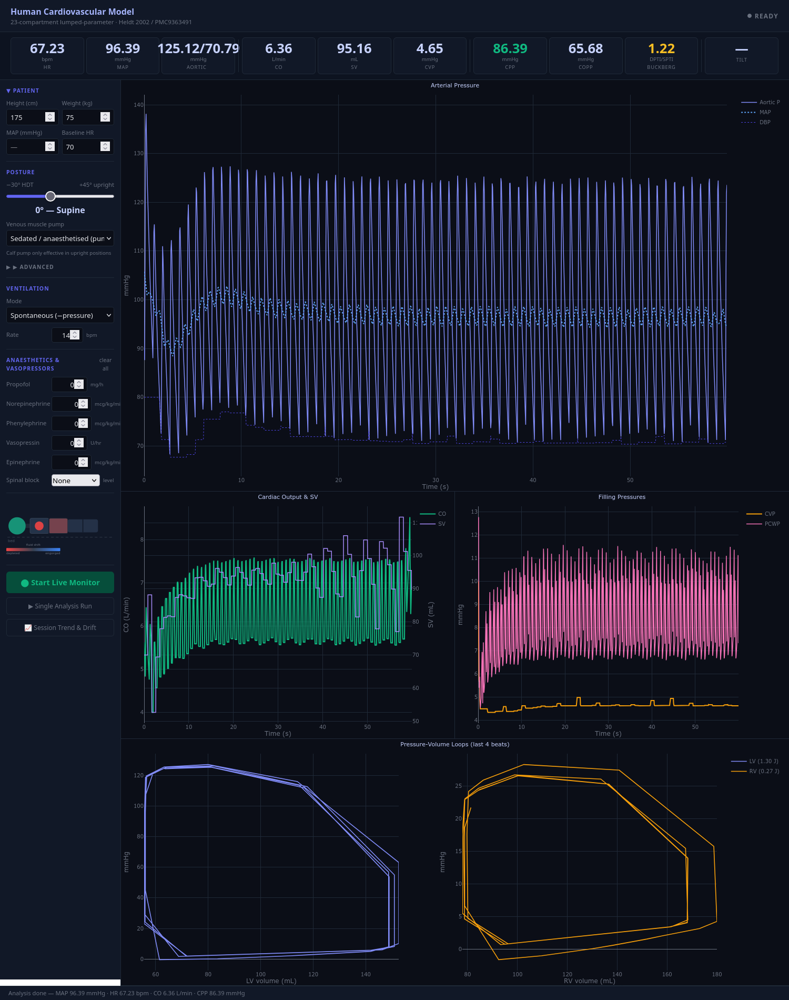
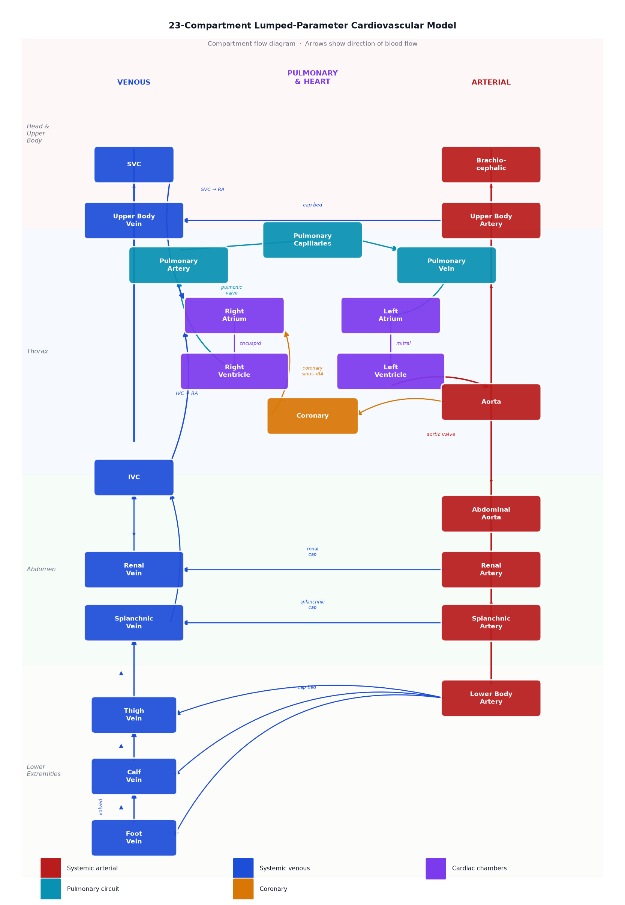

# Cardiovascular System Simulator

> An open-source, lumped-parameter model of human cardiovascular physiology, built for intraoperative and physiological research use.

---

## Overview

The simulator predicts how a patient's circulation responds to posture, vasopressors, fluid, bleeding, ventilation and altered gravity. Inputs scale from the minimal (blood pressure, height, weight, age and sex) to full intracardiac monitoring, so it works with whatever data is available at the bedside.

It is a **work in progress**, and it is built under one rule: **model the physiology as it is measured in people, and never tune a number to make an endpoint come out right.** Every parameter carries a source and an evidence grade. Every validation target is a human measurement matched on site, convention and cohort. A gap that cannot be closed by a structural fix is carried as a strict `xfail` test, so it fails the day it closes and cannot close silently.

One pattern has shaped the project. **Almost every significant error found here was structural, not a calibration problem**, and they shared a signature: *a plausible pressure produced by an implausible volume or flow.* MAP, cardiac output and CVP looked normal through periods when the arteriolar resistance sat on the wrong side of the capillaries, the aortic valve was functionally stenotic, systole lasted a third too short, and the atria could not fill during ejection. None of it was visible in the numbers a clinician watches. So the project measures internal quantities, not only endpoints.

---

## Clinical use cases

| Scenario | What the model predicts |
|---|---|
| **Trendelenburg (head-down tilt)** | CVP and filling, stroke volume and cardiac output, MAP |
| **Reverse Trendelenburg / beach chair** | Venous pooling, orthostatic compensation, cerebral perfusion pressure |
| **Vasopressor titration** | MAP, CO, SVR and heart rate for noradrenaline, phenylephrine, vasopressin, adrenaline |
| **Intraoperative hypotension** | Fluid responsiveness (PPV, passive leg raise), haemodynamic reserve, haemorrhage |
| **Spinal and general anaesthesia** | Sympathetic block, propofol venodilation |
| **Postoperative bed rest** | Cardiovascular adaptation to the supine position |

Microgravity, Mars and Moon gravity are included because weightlessness and bed rest are cardiovascular analogues: both remove orthostatic stress and shift blood centrally. Running the model across the full gravitational range tests the coherence of its hydrostatics.

---

## Quick start

```bash
git clone https://github.com/moelgaardjesper/human-cardiovascular-model.git
cd human-cardiovascular-model
pip install -r requirements.txt

python3 -m api.app          # web interface at http://localhost:5000
pytest                      # fast suite, the regression ratchet (~2 h)
pytest -m slow              # minutes-to-hours dynamics, run on demand
```

---

## Interface



*The analysis view: derived vitals; the aortic pressure waveform with MAP and DBP; cardiac output and stroke volume; filling pressures (CVP and PCWP); left and right ventricular pressure-volume loops with stroke work. The screenshot predates the October 2026 cardiac rebuild, so its numbers are not current. The UI runs fully offline (Plotly is vendored).*

- **Patient panel** — height, weight, age, sex, MAP, HR; optional cardiac output, ABI, CVP, PCWP, PAP.
- **Scenario panel** — tilt (−30° to +45°), vasopressor and dose, spinal block height, ventilation mode, gravity.
- **Output panel** — arterial waveform, cardiac output, CVP, heart rate. A BP-source selector shows central aortic, arterial-line or cuff pressure, so a simulated reading can be compared with the modality actually in use.
- **Live mode** — runs continuously at about real time, with tilt, drugs and ventilation adjustable mid-run.
- **Session trend / drift view** — measured values can be entered as markers on the model's trend. The model runs as a **predictor and is never auto-matched to a measurement**: the gap between the two is the clinical signal (bleeding, sepsis, a drug error), and auto-tracking would erase it.

---

## What the model is

### The circuit

25 compartments: 7 systemic arterial, 10 systemic venous, 4 cardiac chambers, 3 pulmonary and 1 coronary. The lower limb is split into foot, calf and thigh veins, and the inferior vena cava into three segments, so each joins at its own anatomical height. Heights come from anatomy (Winter 2009 joint positions, Dempster segment centres; gut and kidney blood at L1) and scale with stature. Gravity acts on every flow path, and with the heart stopped the blood stays still at any tilt. The limb veins follow a nonlinear collapsible-tube law, stiffening where Halliwill 1999 measured it in man.



### The heart

Each chamber is a time-varying elastance. What has been rebuilt against human measurement:

- **Systole is timed as in man.** Ventricular contraction follows the human elastance curve measured by Senzaki 1996, timed in seconds from Weissler's systolic time intervals and the electromechanical delay of Manolas 1975. Ejection time tracks Weissler from 60 to 130 bpm.
- **An aortic characteristic impedance** sits between the valve and the aortic compliance. Central systolic and diastolic pressure are reported at the aortic root, where a catheter reads them.
- **The left ventricle fills along the Klotz 2006 curve**, measured in 80 human hearts, which gives a Starling plateau from structure. The right ventricle keeps a linear wall; the Klotz curve failed there.
- **The atria fill while the ventricles eject.** The ventricles empty mostly by pulling the valve ring toward the apex, which enlarges the atria (Carlsson 2004, Stephensen 2014). Atrial filling during ejection is an outcome, not an input: 62 % of the ejected volume, against Carlsson's 64 %.
- **The atria are sized and timed on cast-validated MRI** (Järvinen 1994, appendage included). The right atrium's unstressed volume is pinned on its maximum volume and each atrium's contraction on its atrial ejection fraction. The right-atrial waveform then matches catheter data that set nothing (Condos 1987, Ferguson 1989).
- **The pericardium is a structure of its own**, holding all four chambers and any effusion, so tamponade emerges. Its capacity is calculated from each patient's own chamber walls at sourced end-diastolic pressures: it just meets the heart at end-diastole and is slack through a normal beat. That reading follows several labs (Burger 1995, Mangano, Carlsson 2005, Sutton 1977). The single-lab view that it carries right-atrial pressure at rest was weighed and not followed. Its stiffness above the knee is pinned on human saline loading (Bhella 2014).

### The reflexes

- **Arterial baroreflex**, heart-rate arm from Fritsch 1989, plus resistance and venous-tone arms.
- **Cardiopulmonary reflex**, reading the cycle-mean right atrial cavity pressure. It speeds the heart when filling falls (LBNP data). It does not slow it when filling rises, because four labs measured no slowing in healthy volunteers. No Bainbridge acceleration is modelled, because no human magnitude has been read.
- **Limb venous reflex** with the transient time course Samueloff 1966 measured.
- **Reflexes age** from Gribbin 1971's measured relation, a 5-fold fall in responsiveness from 25 to 68.

### Slower processes and drugs

- **Minutes to hours** (`slow_dynamics.py`, on its own coarse clock): venous stress relaxation, Starling transcapillary filtration and refill, interstitial compliance, RAAS/ADH.
- **Pharmacology:** Hill-equation dose-response for noradrenaline, phenylephrine, vasopressin, adrenaline, propofol and spinal anaesthesia, acting on resistance, venous tone, contractility and heart rate.
- **Ventilation:** spontaneous and mechanical, intrathoracic pressure applied to every thoracic compartment, respiratory sinus arrhythmia, PEEP.

### The patient

Patients scale from the reference by body surface area, sex (Luu 2022, Gao 2022 chamber volumes) and age (arterial stiffening, ventricular volumes, reflex responsiveness). Three input tiers:

| Tier | Inputs | What is estimated |
|---|---|---|
| **1 — Minimal** | MAP, height, weight, age, sex | Everything, by allometric scaling (Mosteller BSA) |
| **2 — Intermediate** | + cardiac output, ABI | Arterial resistance, peripheral disease |
| **3 — Advanced** | + CVP, PCWP, mean PAP | Intracardiac calibration |

---

## How it is validated

- **Every number has a source, and the convention is part of the number.** A pressure constant states its site, whether it is transmural or intraluminal, and its averaging window. Cuff against central pressure, trough against mean CVP, and breath-hold against free-breathing MRI have each caused a false "error" here before they were caught.
- **Evidence grades A–F.** A matched human measurement (A) or independent agreeing sources (B) may be calibration targets. Weaker evidence is used as a labelled best guess. A parameter with no literature value (E) is allowed only if it is pinned from one endpoint and tested on others. A parameter kept against contradicting literature (F) must be named publicly.
- **Pin, don't pick.** When a parameter is set from one human measurement, the measurements it was not set from are the test. Several pins in the cardiac rebuild then matched data they never saw.
- **The suite is a ratchet.** A change that cannot leave it green without weakening a test is a finding to report, not a licence to retune. Known gaps are strict `xfail`s, and each fails the moment it starts passing. **No band has been widened to absorb a model result.** The suite-wide convention is a 1 SD band around the source mean.
- **Guards are sabotage-verified.** A new guard is trusted only after the mechanism it watches has been broken and the guard has fired.
- **Blind validation.** Predictions for unseen studies are committed publicly before the result is known (see [Blind validation](#blind-validation-in-progress)).

### Test suite (measured 2026-10-17)

| tier | command | result |
|---|---|---|
| fast — the ratchet | `pytest` | **131 passed, 22 strict xfails, 0 failed** (8 slow tests deselected) |
| slow — minutes to hours | `pytest -m slow` | 7 passed at the v1.0.0 freeze; not re-run since |
| overnight — 24 h refill | `pytest -m overnight` | 1 strict xfail, predicted before it was run |

The model cites **106 distinct sources: 65 asserted by a passing test, 9 appearing only in strict xfails (recorded disagreements), and 32 cited in the code as parameter justifications that no test repeats.** These are different claims and are counted separately. The list is generated by `tools/source_index.py`, never kept by hand.

---

## Validation results

All values re-measured on **2026-10-17**, at the current commit, through the same helpers the tests use. Scenario rows use the test protocol (a 40 s run, averaging its second half), so a few posture responses read slightly larger than in a fully settled run.

### The resting operating point — reference patient (male, 55 y, 175 cm / 70 kg)

| Quantity | Model | Human reference |
|---|---|---|
| MAP (central, integrated) | 95.8 mmHg | 95 ± 7 (McEniery 2005, males 50–59) |
| Central systolic / diastolic | 137 / 80 mmHg (pulse pressure 57) | invasive-equivalent ~123 / 72, PP ~50 ± 7 (McEniery corrected for cuff calibration, Cheng 2013) |
| Heart rate, stroke volume, CO | 68 bpm, 93 mL, 6.2 L/min | HR 65 ± 11 (McEniery); SV index 46 ± 8 mL/m² (Luu 2022) |
| CVP (catheter mean) / PCWP | 4.6 / 8.1 mmHg | RA 3 [2–6] (Richter 2021); PCWP 8 ± 2 (Condos 1987) |
| LV end-diastolic volume, EF | 80 mL/m², 64 % | 74 ± 13 mL/m², 62 ± 6 % (Luu 2022) |
| RV end-diastolic volume | 95 mL/m² | 86 ± 16 (Luu 2022) |
| RA maximum volume | 83 mL/m² | ~81 ± 11, appendage included, cast-corrected (Järvinen 1994) |
| LA maximum / minimum volume | 60 / 25 mL/m² | 52 ± 9 / 24 ± 5 (Järvinen 1994) |
| Atrial filling during ejection | 62 % of ejected volume | 64 % (Carlsson 2004) |
| RA waveform (a wave above mean; x descent below) | +2.1 / −3.2 mmHg | ~+2 (Condos 1987); ~−3 (Ferguson 1989) |
| Pulmonary blood volume | 505 mL | 526 ± 87 (Ugander) |
| Total blood volume | 5.13 L | |

### Scenarios

| # | Scenario | Reference | Literature | Model (2026-10-17) | |
|---|---|---|---|---|---|
| 1 | 20° head-down, normovolaemic | [Sejersen 2022](https://doi.org/10.14814/phy2.15216), 10 healthy men | ΔSV ≈ 0, ΔCO ≈ 0, ΔMAP +2 (n.s.) | ΔSV +15.2 mL, ΔCO +0.83, ΔMAP +9.1 (a settled 90 s run: ΔSV +6) | magnitude a known gap |
| 2 | −15° Trendelenburg | [Likhvantsev 2025](https://doi.org/10.1053/j.jvca.2024.10.001), meta-analysis n=333 | ΔCVP +4.13 (CI 2.42–5.84), ΔCO +0.33, ΔSV +8.27, ΔHR −1.65 | ΔCVP **+2.16**, ΔCO +0.63, ΔSV +12.9, ΔHR −2.0 | ✓ CVP inside the CI |
| 3 | −30° Trendelenburg | Likhvantsev 2025; [Sibbald 1979](https://pubmed.ncbi.nlm.nih.gov/467083/) | as above; MAP maintained | ΔCVP +6.05, ΔCO +0.75, ΔSV +14.4, ΔMAP +10.1 | CVP just above the CI |
| 4 | 6° head-down vs 20° upright | [Verdini 2019](https://doi.org/10.1038/s41598-019-39360-6), 17 men | HR lower head-down; MAP lower head-down | HR 66.3 vs 73.9 ✓; MAP 105.5 vs 85.6 (order opposite) | ✓ on HR |
| 5 | 30° head-up | [Wieling 1998](https://doi.org/10.1042/cs0940347) | SV and CO fall, MAP defended (at 90°: MAP +1 ± 7) | ΔSV −44 %, ΔCO −36 %, ΔMAP −24.6 | direction ✓; MAP falls too far |
| 6 | Graded head-up 0 → 20 → 30° | [Sarafian 2017](https://doi.org/10.3389/fphys.2016.00656) | HR up, CO down, monotonic | HR 68 → 74 → 77, CO 6.29 → 4.79 → 4.05 | ✓ |
| 7 | Cerebral perfusion at 45° upright | [Pohl & Cullen 2005](https://pubmed.ncbi.nlm.nih.gov/15983529/) | falls; risk below 50 | 90 → 40 mmHg | direction ✓; level a known gap |
| 8 | Passive leg raise | [Monnet 2016](https://doi.org/10.1007/s00134-015-4134-1), 21 studies | responder ≥ +10 % CO; specificity 0.91 | normovolaemic +9.2 % (non-responder ✓); after 1200 mL +62 % ✓ | ✓ |
| 9 | Pulse pressure variation, ventilated | [Michard & Teboul 2000](https://doi.org/10.1164/ajrccm.162.1.9905119) | > 13 % predicts fluid response | normovolaemic 8.8 % ✓; 1000 mL bleed 25.1 % ✓; after fluid CO +88 %, PPV 23.4 % | ✓ (the fall in PPV with fluid is small) |
| 10 | Saline loading, external share | [Bhella 2014](https://pubmed.ncbi.nlm.nih.gov/25236519/), healthy seniors | ΔRAP / ΔPCWP 0.59–0.64 | 0.62 (the pin) | pinned |
| 11 | Microgravity CVP | [Buckey 1996](https://pubmed.ncbi.nlm.nih.gov/8853498/) | orbit ~2.5, above upright Earth | 4.54 vs 2.01 at 45° upright | ✓ order |
| 12 | Phenylephrine, young men | [Schäfers 1999](https://pubmed.ncbi.nlm.nih.gov/10073742/) | ΔMAP +28 (21.3–34.7), ΔHR −16, ΔCO −1.15, ΔSV +9 | 4 µg/kg/min: ΔMAP +20.2, ΔHR −15.1, ΔCO −1.24, ΔSV +3.1 | pressor ✓ at plateau (+21.8); CO edge at 6 µg/kg/min |
| 13 | Noradrenaline vs phenylephrine, spinal | [Ngan Kee 2015](https://doi.org/10.1097/ALN.0000000000000601), n=104 | NE preserves CO better; NE HR higher | CO 5.92 vs 5.42; HR 64 vs 61 | ✓ |
| 14 | Vasopressin dose-response | [Patel 2002](https://doi.org/10.1097/00000542-200203000-00011) | MAP rises with dose; CO maintained | MAP 100 → 127 → 136; CO 6.29 → 5.73 | ✓ |
| 15 | Adrenaline dose-response | [Freyschuss 1986](https://doi.org/10.1042/cs0700199) | CO rises with dose; MAP higher at high dose | asserted pattern passes in the suite | ✓ |
| 16 | Spinal anaesthesia ~T4 | [Malmqvist 1987](https://doi.org/10.1111/j.1399-6576.1987.tb02605.x) | MAP falls; CO maintained | asserted pattern passes | ✓ |
| 17 | Buckberg index with heart rate | [Buckberg 1972](https://pubmed.ncbi.nlm.nih.gov/4667030/) | falls with tachycardia | 1.39 at 70 bpm → 0.45 at 160 bpm | direction only (see limitations) |
| 18 | Noradrenaline postcapillary constriction | Abboud & Eckstein 1968 | venous/arterial slope ratio 1.80 | 1.84 | ✓ |
| 19 | Transcapillary refill, 2 h | Lister 1963 | incomplete at 2 h | passes (slow tier) | ✓ |

### Recently closed, by structure rather than calibration

- **Head-down and leg-raise over-filling.** With the pericardium's knee at the resting heart, a full heart stops filling while a bled heart still responds. The Monnet non-responder and the Likhvantsev CVP rise at −15° closed together.
- **Systolic timing.** Ejection lasted 193 ms at rest (man ~294) and shrank with the beat. With measured timing and an aortic impedance, peak aortic flow per stroke volume then matched MRI without being used.
- **The atria.** Their old sizes came from an atrial body without the appendage, and their contraction double-counted the emptying the valve ring now does. Pinned on Järvinen, the right-atrial waveform matched catheter data unseen.
- **Phenylephrine's pressor response** reached Schäfers' band after the atrial pins, and stroke volume now rises at low doses where it fell.

---

## Limitations

The frozen list is in [`FREEZE.md`](FREEZE.md); if the two disagree, `FREEZE.md` wins for the v1.0.0 artefact. Each item below is carried as a strict `xfail` unless stated.

**The heart**
- **The left-heart walls are too stiff on loading.** Opening the pericardium in the model *raises* the wedge pressure rise on saline loading (+9 → +22 mmHg), where Borlaug 2018's patients' rise fell by 67 %. Older and female left ventricles also start too high on their filling curves (resting wedge 13–18 mmHg against Bhella's 10.9 ± 2.0). The likely missing structure is **ventricular interdependence through the septum**, the next work item.
- **Head-down filling is still too large** at 20° (Sejersen) on the test protocol.
- **Atrial reservoir is split unevenly.** Left-atrial emptying runs +1.2 SD and right-atrial −1.2 SD (Järvinen). The probable cause is how the valve ring's swept volume is shared between the atria.
- **Tamponade needs ~300 mL, not 200.** The larger, measured right atrium enlarges the calculated pericardial capacity. Beck's 200 mL is historical and read only second-hand.
- **The reference patient rescales itself** when entered by its own haemodynamics, and tier-3 calibration does not converge on entered values.

**Posture**
- **Orthostatic pressure falls too far.** MAP drops ~25 mmHg at 30° and ~40 at 45°, where people hold it near supine. Cerebral perfusion at 45° is therefore too low. The leading suspect is the absent leg muscle pump.
- **Tilt-response differences by age** (White 1997) and the limb venous reflex's time course under the new heart are open.
- **Intracranial pressure** is clamped flat above about 29° head-up, so the model must not be used to rank two head-up postures against each other.

**Pressure waves**
- **Pulse pressure amplification is inverted.** A lumped model has no wave travel or reflection, so central and peripheral pulse pressure cannot both be right. Brachial pulse pressure reads ~29 mmHg. Do not split the difference.
- **The Buckberg index magnitude is biased high**, because brachial diastolic pressure is too high and systolic too low. Its fall with heart rate is supported; its absolute value is not, and it errs in the unsafe direction.

**Vessels and fluid**
- **The venous return curve test** holds each airway pressure for 60 s, where Maas held briefly. The reflex acts during the hold, so the curve rotates. The fix is the protocol (short holds), not the band.
- **No cellular compartment.** 24 h refill undershoots by design; this was predicted before the run.
- **Single-compartment splanchnic and upper-body veins.** Their hydrostatic gradient is not represented, and the upper-body compartment mixes skin (mobilisable) with muscle (not).
- **The arterial share of blood volume has no human source**, and probably cannot have one: no tracer separates arterial from venous blood in vivo. It is deliberately not tuned.

**Drugs and anaesthesia**
- **No opioid**, so the anaesthetic heart rate is wrong. **Propofol** is right for the wrong reason (it was fitted to an endpoint). Phenylephrine's stroke volume rise is smaller than Schäfers' and Højlund 2024's.
- **Phenylephrine and the splanchnic veins** carry a grade-F parameter: kept for Schäfers' flow response, while Bell 1991 measures the bed moving the other way in conscious man.

---

## Blind validation (in progress)

Every comparison above used literature available while the model was built, which is the ordinary condition of a modelling paper and why such papers persuade little. [`preregistration/`](preregistration/) fixes the order: for each new study a prediction, with direction, magnitude and an interval, is committed and **pushed before the result is seen**. A public commit carries a timestamp nobody involved can move. The model is frozen at `v1.0.0` for the phase.

Studies the model cannot be asked are logged in [`preregistration/EXCLUDED.md`](preregistration/EXCLUDED.md) with the mechanical reason; that list maps the architecture's limits. Whether a study is out-of-sample is checked mechanically: `python3 tools/check_insample.py <PMID or DOI>` searches every identifier already cited.

---

## Architecture

```
model/
  compartments.py   25-compartment parameter set; collapsible-tube limb veins
  heart.py          elastance chambers: Senzaki/Weissler systolic timing, Klotz LV
                    diastole, AV-plane coupling, pericardium (capacity calculated)
  gravity.py        hydrostatic pressure on every flow path; smooth tilt
  baroreflex.py     arterial + cardiopulmonary reflexes; limb venous arm; ageing
  respiration.py    spontaneous and mechanical ventilation; RSA
  slow_dynamics.py  minutes-to-hours mechanisms on a coarse clock
  perfusion.py      derived cerebral (CPP/ICP) and coronary (Buckberg) outputs
  pharmacology.py   Hill-equation dose-response for six agents
  aging.py          age laws: arterial compliance, chamber volumes, reflexes
  patient.py        BSA, sex and age scaling; three input tiers
  circulation.py    ODE system (Euler, dt = 1 ms); run_simulation()
api/                Flask REST API and live mode (server-sent events)
frontend/           plain HTML + vendored Plotly, no build step, runs offline
tests/              fast suite (the ratchet) and slow / overnight tiers
tools/              reporting and audit tools (source_index, check_insample,
                    validation_table, consistency_audit, parameter_audit, ...)
```

The reporting tools assert nothing; anything that reports numbers without asserting them is re-measured on a schedule, because nothing fails when it goes stale.

---

## The sources this model rests on

A representative list of load-bearing sources, not the bibliography (`tools/source_index.py` generates that):

| Source | Load-bearing for |
|---|---|
| **Heldt T et al.** (2002) *J Appl Physiol* 92:1239–1254 | The structural ancestor: topology, time-varying elastance, the 4-step baroreflex, the hydrostatic equation. Its topology survives; almost none of its numbers do. Not a validation target. |
| **Luu JM et al.** (2022) *J Cardiovasc Magn Reson* 24:2 | Ventricular volumes by sex and age (CMR, n = 3206). |
| **Järvinen VM et al.** (1994) *Am J Cardiol* 73:1135 and *Radiology* 191:137 | Both atria, appendages included, cast-validated MRI. |
| **Carlsson M et al.** (2004) *Am J Physiol Heart Circ Physiol* 287:H243; **Stephensen S et al.** (2014) | Total heart volume variation and AV-plane pumping. |
| **Senzaki H et al.** (1996) *Circulation* 94:2497; **Weissler AM et al.** (1968) *Circulation* 37:149 | The human elastance curve and systolic time intervals. |
| **Klotz S et al.** (2006) *Am J Physiol Heart Circ Physiol* 291:H403 | The LV end-diastolic pressure-volume relation. |
| **Bhella PS et al.** (2014) *JACC* 64:1257; **Burger W et al.** (1995) *Chest* 107:46 | Pericardial constraint on loading; no constraint at normal filling. |
| **McEniery CM et al.** (2005) *JACC* 46:1753; **Cheng HM et al.** (2013) *Int J Cardiol* 167:1867 | Central pressures by decade; the cuff-calibration bias of tonometry against invasive pressure. |
| **Maas JJ et al.** (2009) *Crit Care Med* 37:912 | Invasive human venous return curves. |
| **Gelman S** (2008) *Anesthesiology* 108:735 | The compliant/non-compliant venous split behind venous tone. |
| **Lister J et al.** (1963) *Ann Surg* | Transcapillary refill after haemorrhage in man. |

Related modelling work, referenced and not implemented: [VoM-PhyS](https://doi.org/10.1038/s41598-022-18831-3) (3D multiscale), [VaMpy](https://openresearchsoftware.metajnl.com/articles/10.5334/jors.159) (1D wave propagation, which this model cannot express), and Marino 2024 ([PMID 38507180](https://pubmed.ncbi.nlm.nih.gov/38507180/)), an independent precedent for the two-timescale architecture.

---

## How the model got here

The model began as a Heldt-derived circuit and has been rebuilt layer by layer. Each layer was found by refusing to tune the one above it. The main steps:

1. **Venous system rebuilt** to physiological compliance and stressed volume (blood volume 3.8 → 5.1 L), with a collapsible-tube law for the limb veins.
2. **Wiring errors corrected:** the arteriolar resistance moved to where the arterioles sit (capillary pressure 10.8 → 24.5 mmHg); a dead venous-tone variable made live; resistance to venous return set to Maas's 15 % of systemic.
3. **All four chambers and the valves rebuilt** against CMR; the "stroke volume ceiling" was a stenotic aortic valve.
4. **Thoracic pressure applied where vessels cross the chest wall**, ending a pleural swing across the aortic valve; PPV 43 → 9 %.
5. **Reflexes rebuilt** on human gains, made one-sided where humans are, and aged.
6. **Gravity made to do no work on a closed circulation**, and a fitted chest pressure that cancelled the error withdrawn (Drummond 1978 measured none).
7. **Legs, abdomen and vena cava given anatomical heights**; the Klotz LV curve.
8. **The cardiac rebuild (October 2026):** measured systolic timing and an aortic impedance; the AV-plane coupling; the pericardium as its own structure; the atria pinned on Järvinen.

Withdrawn claims are listed in [`RETRACTIONS.md`](RETRACTIONS.md). The full history is in `git log`.

---

## Contributing

Contributions are welcome, particularly:

- **Ventricular interdependence** (septal coupling of the two ventricles)
- **Leg muscle pump** (calf compression, venous valves)
- **Additional drugs** (opioids, dobutamine, milrinone, metaraminol)
- **Better patient calibration** (tier 3 fitting from monitor data)

Please open an issue before starting a large change.

---

## License

**Business Source License 1.1** — see [LICENSE](LICENSE).

| Use | Allowed? |
|---|---|
| Personal use | ✓ Free |
| Academic / research | ✓ Free |
| Non-commercial education | ✓ Free |
| Commercial use (product, service, clinical tool) | Contact licensor |

On **2030-01-01** this license converts to **Apache 2.0**.
Commercial licensing: moelgaard.jesper@gmail.com

---

## Citation

```
Moelgaard J et al. Cardiovascular System Simulator.
GitHub: https://github.com/moelgaardjesper/human-cardiovascular-model
Licensed under BSL 1.1 — free for research and personal use.

Structural basis:
  Heldt T et al. (2002) J Appl Physiol 92:1239-1254
  Mohammadyari P et al. (2022) Sci Rep — PMC9363491
```
